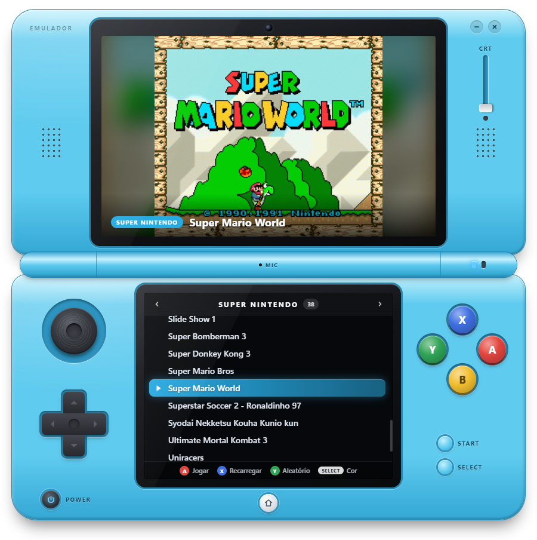

# Emulador

Launcher de jogos retrô com visual de console portátil de tela dupla (inspirado no Nintendo 3DS), feito com Electron, React e TypeScript.

Ele lê as ROMs de uma pasta, mostra a capa animada do jogo na tela de cima e abre o jogo no emulador certo com um Enter, um clique duplo ou o botão A do controle.



> O Emulador é o launcher (o "menu" do console); os jogos rodam em emuladores externos. O repositório já vem com o [Snes9x](https://www.snes9x.com/) (Super Nintendo) e o Kega Fusion (Mega Drive) configurados, e outros podem ser adicionados por um arquivo JSON.

## Funcionalidades

- **Biblioteca automática:** o app varre as pastas de ROMs, sem lista manual para manter.
- **Várias plataformas:** troque entre Super Nintendo, Mega Drive etc. com ← e →. Novas plataformas entram só pela configuração.
- **Capas animadas** (GIF, WebP, PNG, JPG), exibidas na proporção certa com um fundo desfocado. Jogos sem capa ganham um cartão gerado com o nome.
- **Teclado, mouse e controle (gamepad)**, com busca por digitação ("sup" leva a "Super Mario…").
- **Quatro cores de console** (aqua, branco, preto e vermelho), trocadas pelo SELECT.
- **Filtro CRT:** o slider ao lado da tela de cima adiciona scanlines de TV de tubo à capa.
- **Botão Power:** desliga as telas com efeito de estática e liga com animação de boot.
- **Janela ajustável:** cabe em telas menores automaticamente e aceita zoom com Ctrl + roda do mouse.
- **Lembra o último jogo, a cor, o filtro e o tamanho da janela** entre uma sessão e outra.
- **Mensagens claras de erro e configuração:** emulador ausente, pasta vazia, JSON inválido.
- **Seguro por padrão:** a interface roda isolada (`contextIsolation` + `sandbox`) e só conversa com o sistema por uma API mínima.

## Requisitos

- [Node.js](https://nodejs.org/) **22.12 ou superior**
- Windows (o projeto foi feito e testado no Windows; o código não depende dele, mas Linux e macOS exigem configurar emuladores do seu sistema e ainda não foram testados)

## Como rodar

```bash
npm install
npm run dev
```

Pronto: os jogos já aparecem na lista e abrem com Enter. O `npm run dev` também ativa o hot reload, então mudanças na interface aparecem na hora.

### Scripts

| Comando             | O que faz                                                  |
| ------------------- | ---------------------------------------------------------- |
| `npm run dev`       | Abre o app em modo de desenvolvimento, com hot reload      |
| `npm start`         | Compila e abre a versão de produção                        |
| `npm test`          | Roda os testes (Vitest)                                    |
| `npm run typecheck` | Verifica os tipos do TypeScript                            |
| `npm run build`     | Verifica os tipos e compila para a pasta `out/`            |
| `npm run dist`      | Gera o app para Windows em `dist/` (pasta e `.zip`)        |

## Montando a biblioteca

Tudo o que é "conteúdo" fica na pasta `plataforma/`:

```
plataforma/
├── plataformas.json        ← configuração das plataformas
├── capas/                  ← capas dos jogos
│   ├── Super Mario World.gif
│   └── megadrive/          ← opcional: capas específicas de uma plataforma
│       └── Aladdin.gif
├── emulador/               ← emuladores (Snes9x e Kega Fusion), com seus saves
│   └── super nintendo/snes9x-1.60-win32-x64/snes9x-x64.exe
└── roms/                   ← ROMs, uma pasta por plataforma
    ├── super nintendo/
    │   ├── Super Mario World/Super Mario World.smc
    │   └── Chrono Trigger.sfc
    └── mega drive/
        └── Sonic The Hedgehog 2/Sonic The Hedgehog 2.md
```

As ROMs podem ficar soltas na pasta da plataforma ou dentro de uma subpasta por jogo. Arquivos com outras extensões (saves, readmes) são ignorados.

Para adicionar um jogo:

1. Coloque a ROM em `plataforma/roms/<plataforma>/`.
2. Opcionalmente, adicione uma capa em `plataforma/capas/` com o **mesmo nome do arquivo da ROM**.
3. Aperte **X** (ou F5) no app para recarregar a lista.

Para adicionar uma plataforma, coloque o emulador em `plataforma/emulador/` (ou use um caminho absoluto) e inclua uma entrada no `plataformas.json`, como mostrado abaixo.

### `plataformas.json`

```json
{
  "platforms": [
    {
      "id": "snes",
      "name": "Super Nintendo",
      "romsDir": "roms/super nintendo",
      "extensions": [".smc", ".sfc", ".fig", ".swc"],
      "emulator": "emulador/super nintendo/snes9x-1.60-win32-x64/snes9x-x64.exe",
      "args": ["{rom}"]
    }
  ]
}
```

| Campo        | Obrigatório | Descrição                                                                                                                                          |
| ------------ | ----------- | -------------------------------------------------------------------------------------------------------------------------------------------------- |
| `id`         | sim         | Identificador único da plataforma. Também é o nome da subpasta opcional em `capas/`.                                                              |
| `name`       | não         | Nome exibido no menu (padrão: o `id`).                                                                                                             |
| `romsDir`    | sim         | Pasta das ROMs, relativa a `plataforma/`.                                                                                                          |
| `extensions` | sim         | Extensões de arquivo consideradas ROMs.                                                                                                            |
| `emulator`   | não         | Executável do emulador. Caminhos com barra são relativos a `plataforma/`; um nome simples (ex.: `retroarch`) é procurado no PATH. Sem esse campo, a ROM é aberta com o programa padrão do sistema. |
| `args`       | não         | Argumentos passados ao emulador. `{rom}` é trocado pelo caminho da ROM (padrão: `["{rom}"]`).                                                      |
| `covers`     | não         | Associa uma ROM à capa de outro nome, sem duplicar arquivos: `{ "nome da ROM": "nome da capa" }`. Veja [Nomes e capas](#nomes-e-capas).          |

Exemplo com o RetroArch, para abrir em tela cheia com um core específico:

```json
{
  "id": "snes",
  "name": "Super Nintendo",
  "romsDir": "roms/super nintendo",
  "extensions": [".smc", ".sfc"],
  "emulator": "C:/RetroArch/retroarch.exe",
  "args": ["-f", "-L", "C:/RetroArch/cores/snes9x_libretro.dll", "{rom}"]
}
```

### Nomes e capas

O título exibido vem do nome do arquivo, sem as marcações comuns de ROMs: `Superstar Soccer 2 (U) [p1][!].fig` aparece como **Superstar Soccer 2**.

A capa é procurada nesta ordem (sem diferenciar maiúsculas e minúsculas):

1. `capas/<id da plataforma>/<nome do arquivo>.*`
2. `capas/<id da plataforma>/<título limpo>.*`
3. `capas/<nome do arquivo>.*`
4. `capas/<título limpo>.*`

Formatos aceitos: `.gif`, `.webp`, `.png`, `.jpg`, `.jpeg` e `.avif`. Para capas animadas, o **WebP animado** costuma ficar bem menor que o GIF com a mesma qualidade.

Versões, traduções e hacks de um mesmo jogo podem reaproveitar uma capa pelo campo `covers` da plataforma, sem copiar o arquivo. A chave é o nome da ROM (com ou sem as marcações) e o valor é o nome da capa:

```json
"covers": {
  "Superstar Soccer 2 - Ronaldinho 97": "International Superstar Soccer Deluxe"
}
```

Jogos sem capa ganham um cartão gerado automaticamente, com o nome do jogo.

## Controles

| Ação                    | Teclado                   | Controle (gamepad) | Mouse                                   |
| ----------------------- | ------------------------- | ------------------ | --------------------------------------- |
| Navegar na lista        | ↑ ↓                       | D-pad / analógico  | Clique no jogo, no D-pad ou no analógico |
| Pular 6 jogos           | Page Up / Page Down       | —                  | —                                       |
| Primeiro / último jogo  | Home / End                | —                  | —                                       |
| Trocar de plataforma    | ← →                       | D-pad / analógico  | Setas no topo da lista                  |
| Buscar pelo nome        | Digite o nome             | —                  | —                                       |
| **Jogar**               | Enter                     | A ou Start         | Clique duplo, botão A ou START          |
| Recarregar a lista      | F5                        | X                  | Botão X                                 |
| Jogo aleatório          | —                         | Y                  | Botão Y                                 |
| Trocar a cor do console | —                         | Select             | Botão SELECT                            |
| Filtro CRT              | —                         | —                  | Slider "CRT" ao lado da tela de cima    |
| Ligar / desligar        | Tab até o POWER + Enter   | —                  | Botão POWER                             |
| Minimizar               | —                         | Home / Guide       | Botão HOME ou "–" no canto              |
| Zoom da janela          | Ctrl + / Ctrl − / Ctrl 0  | —                  | Ctrl + roda do mouse                    |
| Mover a janela          | —                         | —                  | Arraste pela metade de cima             |
| Fechar                  | —                         | —                  | "×" no canto superior direito           |

No controle, o A é o botão de baixo (padrão de controles de Xbox e da maioria dos controles de PC). O controle só é lido enquanto a janela do launcher está em foco, então os botões apertados durante o jogo não abrem outro jogo por trás.

## Gerando o executável

```bash
npm run dist
```

O resultado fica em `dist/win-unpacked/` (e compactado em `dist/Emulador-<versão>-win.zip`), com a pasta `plataforma/` completa (ROMs, emuladores e capas) ao lado do `Emulador.exe`. Basta abrir e jogar, e novos jogos podem ser adicionados direto nessa pasta.

> Os saves de quem joga pela versão empacotada ficam na cópia dos emuladores dentro de `dist/`. Rodar `npm run dist` de novo sobrescreve essa pasta, então faça backup dos saves antes.

## Estrutura do projeto

```
src/
├── main/          Processo principal (Node): janela, leitura da biblioteca, abertura dos emuladores
│   ├── index.ts       janela, IPC e protocolo cover:// para servir as capas
│   ├── library.ts     varredura de ROMs/capas e validação do plataformas.json
│   ├── launcher.ts    abre o emulador como processo independente
│   └── windowScale.ts tamanho da janela e zoom (Ctrl + roda)
├── preload/       Ponte segura entre o processo principal e a interface (window.emulador)
├── renderer/      Interface em React
│   └── src/
│       ├── App.tsx        estado: plataforma, seleção, power, cor e filtro CRT
│       ├── components/    partes do console (tampa, dobradiça, base, telas, botões…)
│       ├── hooks/         teclado/gamepad, biblioteca e avisos
│       └── styles/        cores dos temas e estilos compartilhados
└── shared/        Tipos e nomes de canais IPC usados pelos dois lados
```

**Tecnologias:** [Electron](https://www.electronjs.org/), [electron-vite](https://electron-vite.org/), [React](https://react.dev/), TypeScript, Sass, [Vitest](https://vitest.dev/) e [electron-builder](https://www.electron.build/).

## Licença

ISC © Patrick Craveiro
